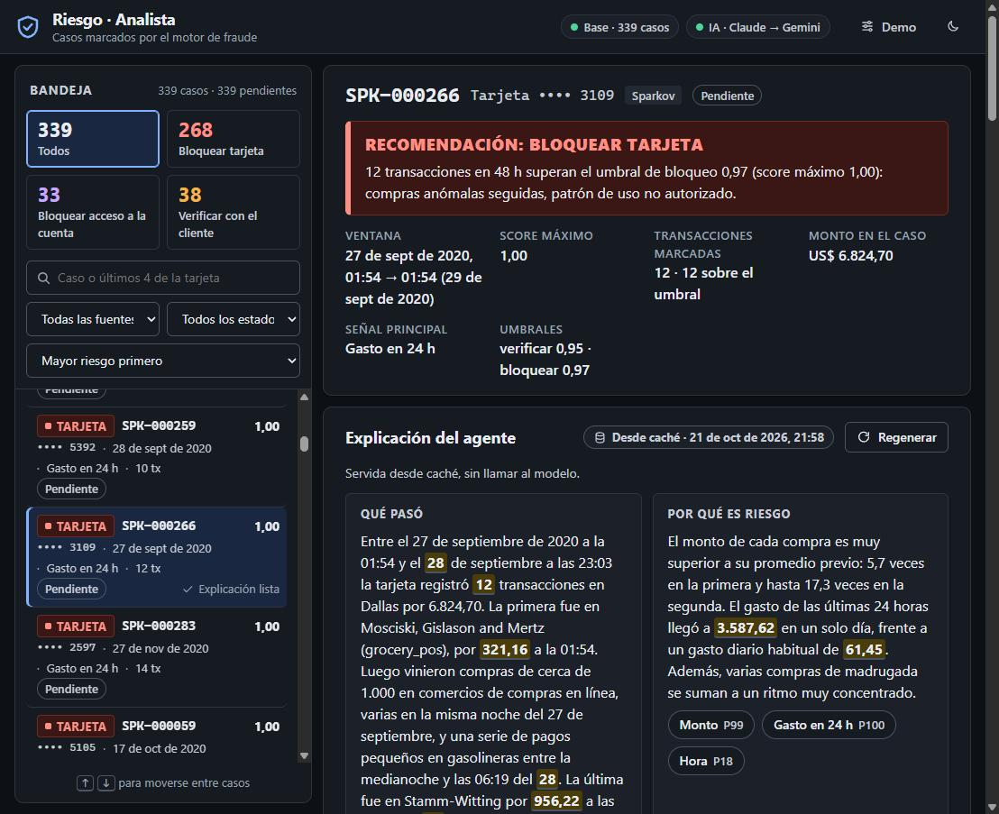
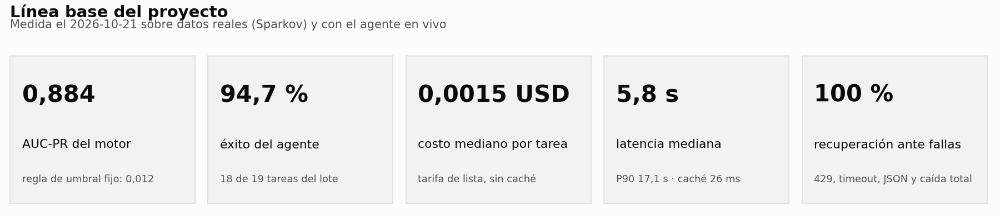
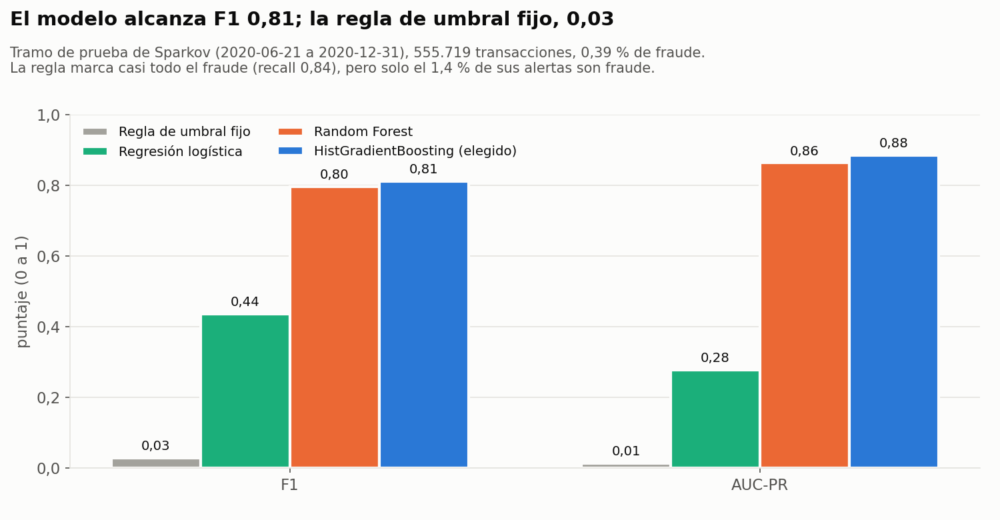

# Detección de fraude bancario: vista del analista con agente

Proyecto del curso Ingeniería de Aplicaciones con IA (Momento 2). Equipo: Jhoan David
Gruezo Gutiérrez y Jeison Nazarit.

Un motor de riesgo (ML clásico, HistGradientBoosting sobre el perfil previo de cada
tarjeta) y un detector determinista de viaje imposible marcan casos de fraude. La app
le muestra al analista la bandeja de casos y, por cada caso, un agente LLM que consulta
la evidencia con sus propias herramientas y explica qué pasó, por qué es un riesgo para
ese cliente y qué se debería bloquear. El agente recomienda; el bloqueo solo existe si
el analista lo confirma. El registro completo de decisiones, la frontera de la IA y la
línea base medida están en [`docs/decisiones.md`](docs/decisiones.md).



**Documentación**

| Documento | Para qué |
|---|---|
| [Guía del proyecto](docs/guia-del-proyecto.md) | Empezar aquí: problema, arquitectura (diagramas), flujo de una explicación, frontera de la IA, cómo se construyó |
| [Registro de decisiones](docs/decisiones.md) | Decisiones técnicas, datos sin RAG, proveedor y modelo, manejo de fallos y la línea base con las cuatro cifras |
| [Requisitos](requisitos/), [diseño](diseno/) y [validación](validacion/) | Qué debía cumplir cada componente, cómo se diseñó y qué encontró su validación |
| [Evaluación](eval/) | Casos dorados, lote de medición y resultados con fecha |
| [Bitácora](decisiones.md) y [plan por sesiones](plan-construccion.md) | La historia completa de decisiones, sesión por sesión |
| [Presentaciones](docs/presentaciones/) | Pitch del 9 de octubre y guiones |
| [Pendientes y Momento 3](docs/pendientes-y-momento3.md) | Qué falta antes del 31 de octubre, el alcance del Momento 3 y el backlog de mejoras |
| [Lista de verificación de la app](docs/prueba-companero-jeison.txt) | Pruebas paso a paso para verificar la app e informar qué está bien, mal o mejorable |

**Cifras clave** (2026-10-21):





La suite de casos dorados pasa 8 de 8. El resto de las gráficas (curva
precisión-recall, hora del fraude, calidad por caso y latencia del lote), con su
lectura, están en la [guía del proyecto](docs/guia-del-proyecto.md#12-resultados-en-gráficas).
Todas se regeneran desde los datos con `python scripts/generar_graficas.py` (necesita
`matplotlib`; las dos de exploración, además, `pandas`, `scikit-learn` y el dataset de Kaggle).

## 1. Prerrequisitos

| Qué | Versión | Para qué |
|---|---|---|
| Docker Desktop (Windows/macOS) o Docker Engine (Linux) con **Compose v2** (`docker compose`, no `docker-compose`) | probado con Docker 29.9.2 y Compose v5.6.0 | levantar la base y la app |
| Puerto **8000** libre en el equipo | — | la vista del analista |
| Conexión a internet la primera vez | — | descargar `python:3.12-slim` y `postgres:16-alpine` y las dependencias de `app/requirements.txt` |
| Bash (Linux, macOS, Git Bash o WSL en Windows) | cualquiera | solo para `./run.sh`; sin Bash se usa el comando de Docker directo |
| Python 3.10 o superior en el equipo | probado con 3.14 | solo para correr `eval/` (usa la biblioteca estándar, no hay que instalar nada) |

No hace falta instalar Python, Postgres ni el dataset de Kaggle para usar la app: todo
corre en contenedores y los casos viajan en `semilla/`, que la app carga sola en
Postgres la primera vez que arranca.

La base de datos no se publica en el equipo (solo la usa la app por la red interna de
Compose), así que un Postgres local en el puerto 5432 no estorba.

## 2. Arranque (un comando)

Obtenga el código, clonando el repositorio o descomprimiendo el ZIP de entrega:

```bash
git clone https://github.com/JhoanGruezo/deteccion-fraude-bancario-ia.git
cd deteccion-fraude-bancario-ia
```

Desde esa carpeta:

```bash
cp .env.example .env     # opcional: run.sh lo crea si no existe
# (opcional) escriba sus llaves en .env: ANTHROPIC_API_KEY y/o GEMINI_API_KEY
./run.sh
```

o, sin Bash:

```bash
docker compose up --build -d
```

Abra **http://localhost:8000**. La primera construcción tarda de 1 a 3 minutos
(descarga de imágenes y dependencias); las siguientes, segundos. `run.sh` espera a que
`/api/salud` responda antes de mostrar la URL y, si algo falla, imprime las últimas
líneas del log.

**Sin llaves la app arranca igual**: la bandeja, el detalle, la línea de tiempo y las
decisiones funcionan, y la explicación de cada caso sale de la plantilla armada por
reglas con las señales guardadas del caso (la interfaz lo dice). Las preguntas libres
al agente sí necesitan al menos una llave.

Para detener: `docker compose down` (conserva la base) o `docker compose down -v`
(borra la base; la semilla se vuelve a cargar al siguiente arranque).

Si el puerto 8000 está ocupado, cambie el lado izquierdo de `ports` en
`docker-compose.yml` (por ejemplo `"8080:8000"`) y abra ese puerto.

## 3. Modelo y proveedor

| Papel | Proveedor y modelo | Tarifa de lista (USD por millón de tokens, entrada / salida) |
|---|---|---|
| Principal | Anthropic **Claude Haiku 5.5** (`claude-haiku-5-5`) | 0,10 / 0,50 |
| Respaldo | Google **Gemini 3.1 Flash-Lite** (`gemini-3.1-flash-lite`) | 0,25 / 1,50 |
| Último escalón (sin red) | Plantilla determinista armada con las desviaciones guardadas del caso | 0 |

Por qué, con lo medido el 2026-10-21:

- **Latencia.** Claude Haiku 5.5 respondía cada llamada con herramientas en 1 a 2 s.
  El modelo que habíamos elegido primero, Gemini 3.8 Flash, estaba saturado ese día:
  respondía 503 o tardaba de 25 a 40 s, por encima del timeout de 25 s por llamada.
  Por eso el respaldo es Gemini 3.1 Flash-Lite, que atendía tool calling en 4 a 17 s.
- **Costo.** Una explicación completa cuesta del orden de una décima de centavo de
  dólar con Haiku (la mediana medida está en `docs/decisiones.md`, sección 9).
- **Tool calling.** El agente necesita llamar herramientas en paralelo y devolver un
  JSON con contrato estricto; los dos modelos lo cumplen y el contrato se verifica en
  código (`app/agente/contrato.py`), no se confía al modelo.
- **Respaldo de otro proveedor.** Un 429 o una caída de un proveedor no tumba al otro;
  la cascada reintenta con espera de 1, 2 y 4 s y luego conmuta (`app/proveedores/cascada.py`).

Las tarifas se tomaron de agregadores de precios (OpenRouter, Apidog, Sentra,
aipricing.guru, anotherwrapper.com, morphllm.com), no de las páginas oficiales de los
proveedores: hay que verificarlas antes de citarlas como definitivas. El costo que
reporta la app es el de lista aunque la cuenta tenga créditos, para que sea comparable.
El orden de la cascada y los modelos se cambian con variables de entorno (abajo).

## 4. Variables de entorno (`.env`)

Todas son opcionales; sin `.env` se usan los valores por defecto. Las llaves van solo
en `.env`, que nunca se entrega ni entra a la imagen (`.dockerignore`).

| Variable | Por defecto | Qué hace |
|---|---|---|
| `ANTHROPIC_API_KEY` | vacía | llave de Claude (proveedor principal) |
| `GEMINI_API_KEY` | vacía | llave de Gemini (proveedor de respaldo) |
| `ORDEN_PROVEEDORES` | `claude,gemini` | orden de la cascada; el primero es el principal |
| `CLAUDE_MODELO` | `claude-haiku-5-5` | modelo de Claude |
| `GEMINI_MODELO` | `gemini-3.1-flash-lite` | modelo de Gemini |
| `CLAUDE_RAZONAMIENTO` | `false` | razonamiento extendido de Claude (más lento y más tokens) |
| `POSTGRES_PASSWORD` | `fraude_dev` | contraseña del Postgres del compose (solo desarrollo; se fija al crear el volumen) |
| `DATABASE_URL` | vacía | vacía = la arma Compose apuntando al servicio `db`; solo se llena para usar otra base |
| `MAX_ITERACIONES` | `6` | límite 1: llamadas al modelo por tarea |
| `PRESUPUESTO_TOKENS` | `40000` | límite 2: tokens de entrada + salida por tarea |
| `TIMEOUT_MODELO_S` | `25` | límite 3: segundos por llamada al modelo |
| `TIMEOUT_HERRAMIENTA_S` | `5` | límite 3: segundos por herramienta |
| `MAX_TOKENS_RESPUESTA` | `2500` | tokens máximos de cada respuesta del modelo |
| `ESPERAS_REINTENTO_S` | `1,2,4` | esperas del backoff ante 429/5xx/timeout antes de conmutar |
| `FALLA_FORZADA` | vacía | falla simulada para todas las tareas: `429`, `timeout`, `json` o `todo` |
| `PERMITIR_FALLAS_DESDE_UI` | `true` | habilita el panel de demo y el parámetro `?falla=` |

El cuarto límite del agente (confirmación humana) no es un número: la herramienta que
escribe (`registrar_decision`) solo crea una propuesta pendiente, y la decisión existe
solo cuando el analista la confirma con su nombre.

## 5. Cómo forzar fallas (reto de la semana 9)

Se simulan antes de llamar a la red, así que no gastan cuota:

| Falla | Qué se ve |
|---|---|
| `429` | el principal responde 429 en todos sus intentos: backoff 1-2-4 s y conmutación a Gemini |
| `timeout` | el principal excede el timeout: reintentos y conmutación |
| `json` | la primera respuesta final llega truncada: reparación o reintento con los errores del contrato |
| `todo` | los dos proveedores caen: la explicación sale de la plantilla, marcada como tal |

Tres formas de pedirlas:

1. **Panel de demo** (botón ⚙ en la cabecera de la app): elige la falla para las
   siguientes tareas.
2. **Por petición**: agregar `&falla=429` (o `timeout`, `json`, `todo`) a
   `/api/casos/{id}/explicacion/stream?regenerar=1`. No cambia el estado global.
3. **Para todo el proceso**: `FALLA_FORZADA=429` en `.env` y `docker compose up -d`.

Cada reintento, conmutación, contrato inválido y respaldo aparece en el panel de
trazas de la app y en `GET /api/tareas/{tarea_id}/trazas`.

## 6. Evaluación (`eval/`)

Con la app arriba y desde la raíz:

```bash
python eval/correr_suite.py    # 8 casos dorados (6 explicaciones + 2 rechazos)
python eval/correr_lote.py     # 19 tareas: las cuatro cifras de la línea base y el ahorro por caché
```

Cada corrida deja `eval/resultados/suite_<fecha>.json|.md` y
`eval/resultados/lote_<fecha>.json|.md`, con la traza de cada tarea. El lote cuesta
unos 3 centavos de dólar por corrida con las tarifas de arriba. Sin llaves, los dos
scripts lo avisan y miden solo la plantilla.

- `eval/casos_dorados.json`: los casos y sus hechos esperados. Se regeneran con
  `python scripts/elegir_casos_dorados.py` (necesita la app arriba); el campo
  `verificado_por` lo llena el equipo después de revisar cada caso a mano, y mientras
  haya casos sin firmar la suite se reporta como "pendiente de verificación humana".
- `eval/cliente_sse.py`: abre un stream como el navegador y muestra eventos y tiempos;
  sirve para depurar un caso: `python eval/cliente_sse.py SPK-000093 --regenerar --falla 429`.

Pruebas unitarias de la app (dentro del contenedor):

```bash
docker compose exec app python -m pytest app/pruebas -q
```

## 7. Regenerar el motor y la semilla (opcional)

No hace falta para usar la app. Requiere el dataset de Kaggle "Credit Card
Transactions Fraud Detection" (Sparkov, licencia CC0): `fraudTrain.csv` y
`fraudTest.csv` en `datos/`, que no viajan en el ZIP (~500 MB). Con Python 3.10+,
`pandas` y `scikit-learn`:

```bash
cd src
python generar_datos.py                        # sintéticos → ../datos/transacciones.csv
python entrenar_modelo.py --fuente sinteticos  # motor sobre sintéticos → ../datos/salidas_sinteticos/
python entrenar_modelo.py --fuente sparkov     # motor sobre Sparkov → ../datos/salidas_sparkov/
cd ..
python scripts/generar_semilla.py              # datos/salidas_* + CSV de Kaggle → semilla/
docker compose down -v && docker compose up --build -d   # recarga la base con la semilla nueva
```

## 8. Estructura del repositorio

```
README.md                 este contrato de arranque
docker-compose.yml        servicios db (Postgres 16) y app (FastAPI)
run.sh                    arranque en un comando
.env.example              plantilla de variables, sin llaves
docs/decisiones.md        registro único: arquitectura, frontera de la IA, datos sin RAG, línea base
eval/                     casos dorados, lote de medición, scripts y resultados con fecha
app/
  principal.py            crea la app FastAPI; aplica el esquema y carga la semilla al arrancar
  config.py               variables de entorno, límites, modelos y tarifas
  api/                    rutas HTTP y SSE (la explicación llega por text/event-stream real)
  agente/                 bucle con los cuatro límites, herramientas, prompts, contrato, plantilla
  proveedores/            clientes de Claude y Gemini (httpx, sin SDK) y la cascada
  db/                     esquema SQL, migración, repositorio (única puerta a la base)
  web/                    frontend sin compilación (HTML, CSS y módulos ES)
  pruebas/                pruebas unitarias (pytest)
  Dockerfile, requirements.txt
semilla/                  casos e historial que la app carga en Postgres (generados)
src/                      motor de riesgo: datos, perfil por tarjeta, modelos, viaje imposible
scripts/                  generar_semilla.py, elegir_casos_dorados.py, empaquetar_entrega.py, generar_graficas.py
docs/img/                 captura de la app y gráficas generadas
requisitos/, diseno/, validacion/   requisitos, diseño y validación de cada componente
docs/guia-del-proyecto.md guía general con diagramas de arquitectura y flujo
docs/presentaciones/      pitch del 9 de octubre y guiones
decisiones.md             bitácora histórica de decisiones (la consolidada está en docs/)
plan-construccion.md      plan y checklist por sesión de planeación
CLAUDE.md                 convenciones de código del proyecto
.claude/skills/           skills-rol con las que se construyó (planear, requisitos, diseñar, construir, validar)
```

## 9. Armar el ZIP de entrega

```bash
python scripts/empaquetar_entrega.py --salida <carpeta>
```

Usa una lista blanca, deja fuera `datos/`, `.env`, `.venv/`, `.git/`, `__pycache__/` y
los `.joblib`, busca patrones de llave en todo lo empaquetado y aborta si encuentra
uno, y mantiene el permiso de ejecución de `run.sh`.

## 10. Créditos y datos

- Dataset real: **"Credit Card Transactions Fraud Detection Dataset"** de Kartik Shenoy en
  Kaggle (licencia CC0), generado con el simulador Sparkov de Brandon Harris. No se
  incluye en el repositorio por tamaño (≈500 MB); la app solo necesita `semilla/`, que
  sí está incluida. Para regenerar el motor, descárguelo y deje `fraudTrain.csv` y
  `fraudTest.csv` en `datos/` (sección 7).
- Los datos sintéticos los genera `src/generar_datos.py`.
- Proyecto académico del curso Ingeniería de Aplicaciones con IA, Universidad
  Cooperativa de Colombia. Ningún dato corresponde a clientes reales.
