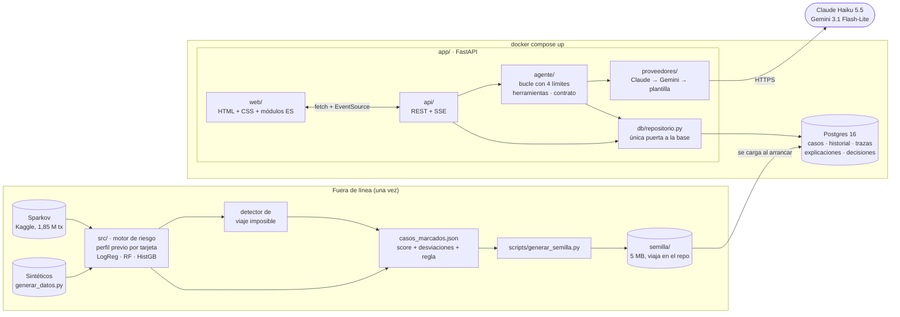
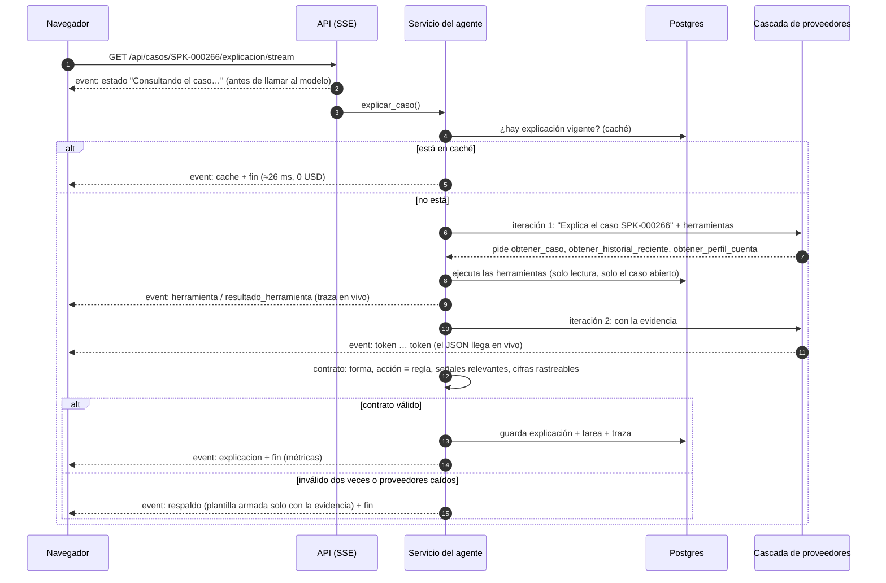
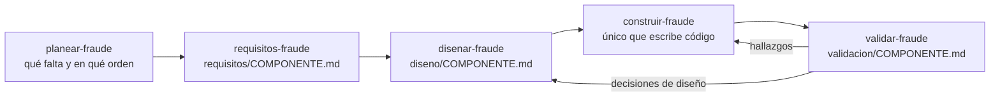
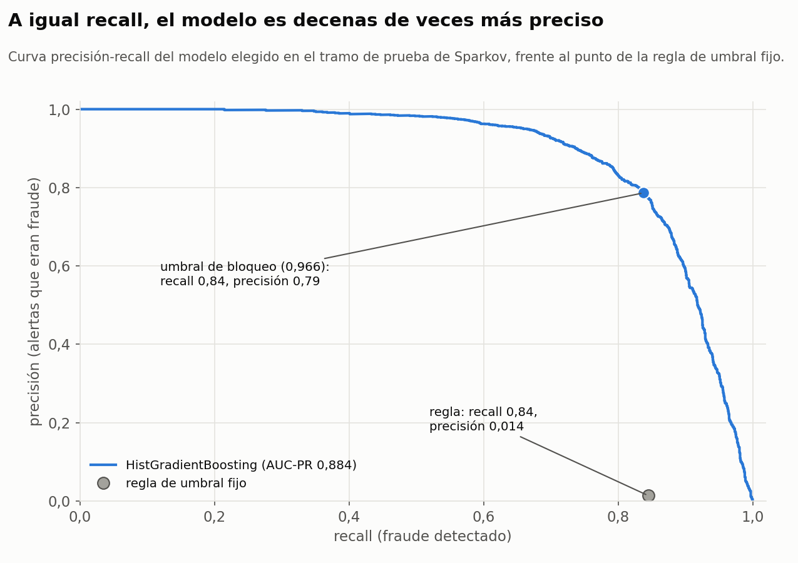
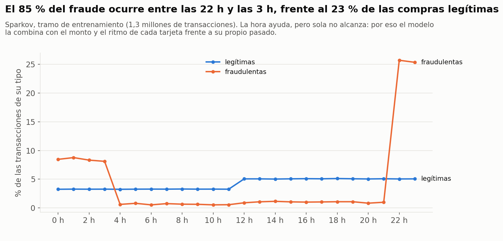
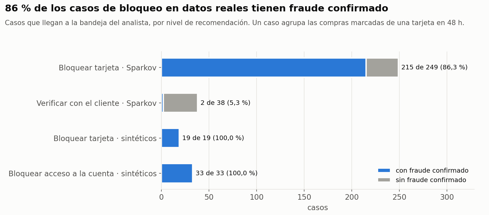
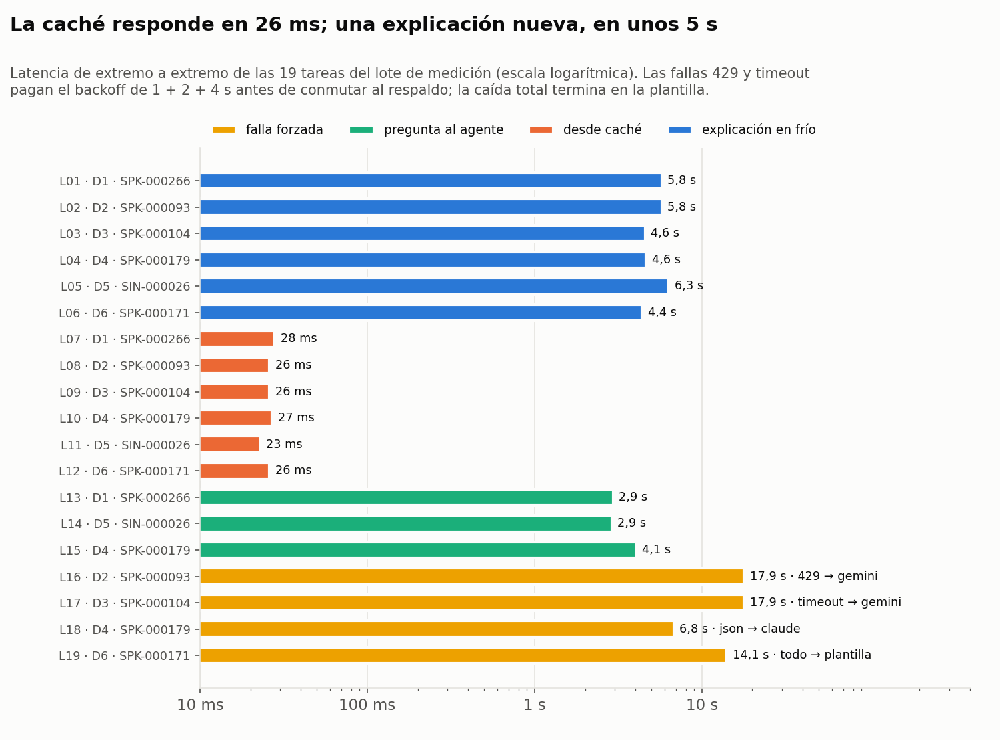

# Guía del proyecto

Esta guía es la puerta de entrada para quien llega al repositorio por primera vez: qué
problema resuelve, cómo está armado, dónde interviene la IA y dónde no, cómo se
construyó y dónde está la evidencia de cada afirmación. Para instalar y correr la app,
el contrato de arranque está en el [README](../README.md). El registro consolidado de
decisiones técnicas y la línea base medida están en [`decisiones.md`](decisiones.md).

Proyecto del curso **Ingeniería de Aplicaciones con IA** (Universidad Cooperativa de
Colombia, profesor Julián Garzón). Equipo: Jhoan David Gruezo Gutiérrez y Jeison
Nazarit.

---

## 1. El problema

Un banco marca transacciones sospechosas, pero al analista de riesgo le llega una
alerta con un número ("score 0,97") que tiene que interpretar. El pedido del profesor
fue ir más allá: que el analista **no tenga que interpretar la calificación**, sino que
reciba el caso ya razonado. Es decir, qué pasó, qué secuencia de compras llevó a la
alerta, por qué eso es raro para *ese* cliente y qué conviene bloquear (la tarjeta, el
acceso a la cuenta o solo verificar con el cliente).

El proyecto cubre dos tipos de fraude concretos:

| Tipo | Cómo se detecta | Por qué así |
|---|---|---|
| **Uso no autorizado** (tarjeta robada o clonada) | Modelo de ML clásico que compara cada compra con el perfil **previo** de su propia tarjeta | El patrón normal es distinto por cliente; una regla de umbral global no lo captura (la medimos: 1,4 % de precisión) |
| **Toma de control por viaje imposible** | Regla determinista: distancia entre compras consecutivas frente al tiempo transcurrido (más de 900 km/h) | Es física exacta; no hay nada que aprender, así que no lleva modelo |

## 2. Qué ve el analista

1. **Bandeja**: los casos marcados, con contadores por nivel de recomendación
   (bloquear tarjeta, bloquear acceso a la cuenta, verificar con el cliente), filtros y
   búsqueda.
2. **Detalle del caso**: la recomendación de la regla y su motivo, la ventana de
   tiempo, el score y los umbrales.
3. **Explicación del agente**: llega en vivo por SSE (*Server-Sent Events*, el servidor
   empuja los fragmentos al navegador a medida que el modelo los genera) y se organiza
   en cuatro bloques: qué pasó, por qué es riesgo, recomendación y lo que no se sabe.
   Cada cifra está resaltada y enlazada a la fila de evidencia de donde sale.
4. **Línea de tiempo**: el historial reciente de la tarjeta con las compras del caso
   resaltadas.
5. **Razones**: cada señal con su rareza (percentil frente a compras normales) y su
   peso en el score.
6. **Conversación**: el analista le pregunta al agente sobre el caso.
7. **Decisión**: el agente puede *proponer* confirmar el bloqueo, descartar o escalar,
   pero nada se registra hasta que el analista lo confirma en un diálogo.
8. **Traza**: en vivo, cada herramienta que pidió el agente, los reintentos, el
   proveedor que respondió, la latencia, los tokens y el costo de la tarea.

## 3. Arquitectura

Las capas están separadas a propósito, y cada una se puede explicar sola:

- **`src/`**: el motor de riesgo. Corre una vez, fuera de la app, y deja los casos con
  toda su evidencia ya calculada.
- **`app/db/`**: el único lugar con SQL. Nadie más toca la base.
- **`app/proveedores/`**: un cliente HTTP propio por proveedor, que traduce un formato
  neutro de mensajes y herramientas al de cada API. Cambiar de proveedor no toca el
  agente.
- **`app/agente/`**: el bucle, las herramientas, el prompt, el contrato de salida y la
  plantilla de respaldo.
- **`app/api/`** y **`app/web/`**: la presentación. No tienen SQL ni llamadas a modelos.

## 4. Cómo se genera una explicación

Si el proveedor principal responde 429 o no responde a tiempo, la cascada reintenta con
esperas de 1, 2 y 4 s y luego **conmuta** al respaldo. Si todo falla, la explicación sale
de una **plantilla** armada en código con la misma evidencia, y la interfaz lo indica.
Las cuatro fallas (429, timeout, JSON roto y caída total) se pueden forzar en vivo desde
el panel "Demo" para mostrarlas en la sustentación.

## 5. Dónde interviene la IA y dónde no

| Pieza | ¿Qué la resuelve? | Por qué |
|---|---|---|
| Score de riesgo de uso no autorizado | **ML clásico** (HistGradientBoosting) | Las reglas serían una por cliente y cambian con el tiempo; el volumen es alto; se tolera variación |
| Viaje imposible | **Código determinista** | Fórmula exacta (Haversine contra tiempo); un error silencioso sería caro |
| Nivel de bloqueo (tarjeta / acceso a la cuenta / verificar) | **Regla determinista** | Entrada ya estructurada; debe ser auditable; el humano confirma |
| Por qué pesó cada señal | **Cálculo** (oclusión + percentiles) | Es aritmética sobre el modelo, no lenguaje |
| Nivel de riesgo en palabras | **Código** (`riesgo_en_palabras.py`) | Cuando lo redactaba el LLM salía al revés en 3 de 9 casos |
| Explicación, conversación y propuesta de decisión | **LLM con herramientas** | Traducir evidencia estructurada a un relato para un analista es lenguaje abierto |
| Bloquear de verdad | **El analista** | Acción con costo de error alto: el agente recomienda, nunca ejecuta |

No se usa RAG: los datos son tabulares y se consultan directamente con herramientas
(justificación en [`decisiones.md` §3](decisiones.md)).

## 6. Datos

- **Sparkov** (Kaggle, "Credit Card Transactions Fraud Detection", licencia CC0):
  1 852 394 transacciones simuladas de 999 tarjetas entre 2019 y 2020, con 0,4–0,6 % de
  fraude. Se eligió sobre PaySim (casi no repite cuentas, así que no hay historia que
  narrar) y sobre el dataset ULB (variables anonimizadas, sin cuenta ni ubicación). No
  se versiona en el repositorio por tamaño: para la app basta la semilla.
- **Sintéticos** (`src/generar_datos.py`): 16 694 transacciones de 400 cuentas
  colombianas, con fraude en ráfagas y viajes imposibles inyectados. Sirven para
  demostrar la tubería y el detector de viaje imposible, no como evidencia del modelo
  (son demasiado fáciles).
- **Semilla** (`semilla/`, 5 MB): los 339 casos marcados (287 de Sparkov y 52
  sintéticos) con su evidencia y 28 206 transacciones de historial. La app la carga en
  Postgres al arrancar.

Limitaciones conocidas y documentadas: Sparkov ubica los comercios al azar a unos
100 km del domicilio, así que el viaje imposible no tiene sentido allí (solo se mide);
en Sparkov, toda tarjeta nueva es fraude (artefacto del simulador, reportado aparte).

## 7. El motor de riesgo, en cifras

Tramo de prueba de Sparkov (jun–dic 2020, 555 719 transacciones), con partición
temporal y perfil calculado solo con el historial previo de cada tarjeta:

| | Precisión | Recall | F1 | AUC-PR |
|---|---|---|---|---|
| Regla de umbral fijo (la idea original) | 0,014 | 0,845 | 0,028 | 0,012 |
| Regresión logística | 0,340 | 0,606 | 0,436 | 0,277 |
| Random Forest | 0,812 | 0,779 | 0,796 | 0,863 |
| **HistGradientBoosting (elegido)** | **0,786** | **0,838** | **0,811** | **0,884** |

A nivel de caso (lo que ve el analista): 249 casos de "bloquear tarjeta", el 86,3 % con
fraude confirmado; 213 de 218 tarjetas con fraude cubiertas. Detalle y validaciones en
[`validacion/motor-riesgo.md`](../validacion/motor-riesgo.md).

## 8. El agente

- **Herramientas propias** con descripciones escritas como prompt
  (`app/agente/prompts.py`): `obtener_caso`, `obtener_perfil_cuenta`,
  `obtener_historial_reciente`, `obtener_score_y_umbrales`, `registrar_decision` (solo
  crea una propuesta) y `declarar_fuera_de_alcance` (rechazos).
- **Cuatro límites activos**: máximo de 6 iteraciones, presupuesto de 40 000 tokens por
  tarea, timeout por llamada al modelo (25 s) y por herramienta (5 s), y confirmación
  humana para toda escritura.
- **Contrato verificado en código** (`app/agente/contrato.py`): la acción debe ser la de
  la regla, las señales citadas deben ser relevantes en el caso, toda cifra debe
  aparecer en la evidencia que devolvieron las herramientas y el texto no puede usar
  jerga interna. Si falla, hay un reintento y luego la plantilla.
- **Proveedores**: Claude Haiku 5.5 como principal y Gemini 3.1 Flash-Lite como
  respaldo. El 21 de octubre Gemini 3.8 Flash respondía 503 o tardaba 25–40 s, mientras
  que Claude respondía en 1–2 s y su tarifa de lista es menor.

**Línea base medida** (2026-10-21, lote de 19 tareas): éxito del 94,7 %, costo mediano
de 0,0015 USD por tarea, latencia mediana de 5,8 s (P90 de 17,1 s) y 100 % de
recuperación ante fallas forzadas. La caché responde en 26 ms. Suite de casos dorados:
8 de 8.

## 9. Cómo se construyó

El proyecto se trabajó con Claude Code y una **cadena de skills-rol** propia del
proyecto (en [`.claude/skills/`](../.claude/skills)). Cada una hace una sola fase y no
invade la siguiente:

- Toda alternativa de arquitectura la decidió el equipo; las skills preguntan y
  documentan, no deciden solas.
- La construcción de la app se repartió entre agentes en paralelo (persistencia,
  agente, vista), cada uno dueño de sus archivos y programando contra interfaces fijadas
  en `diseno/`.
- La validación la hicieron agentes independientes que **volvieron a correr la
  evidencia**, en vez de leer los números reportados. Así aparecieron, entre otros, una
  filtración de datos en el perfil (se calculaba con transacciones futuras) y un error
  de unidades de fecha que convertía la "ventana de 24 h" en una de ~1 000 días. Ambos
  se corrigieron y se volvieron a validar.

La bitácora completa, sesión por sesión, está en [`decisiones.md`](../decisiones.md)
(histórico) y [`plan-construccion.md`](../plan-construccion.md).

## 10. Mapa de la documentación

| Si quiere… | Lea |
|---|---|
| Instalar y correr la app | [README](../README.md) |
| Entender las decisiones y la línea base | [`docs/decisiones.md`](decisiones.md) |
| Ver qué debía cumplir cada componente | [`requisitos/`](../requisitos) |
| Ver cómo se diseñó cada componente | [`diseno/`](../diseno) |
| Ver cómo se validó y qué se encontró | [`validacion/`](../validacion) |
| Correr la evaluación | [`eval/`](../eval) y README §6 |
| Ver la bitácora histórica | [`decisiones.md`](../decisiones.md), [`plan-construccion.md`](../plan-construccion.md) |
| Ver el pitch del 9 de octubre | [`docs/presentaciones/`](presentaciones) |
| Conocer las convenciones de código | [`CLAUDE.md`](../CLAUDE.md) |
| Ver los resultados en gráficas | [sección 12](#12-resultados-en-gráficas) |
| Ver qué falta y el plan del Momento 3 | [`pendientes-y-momento3.md`](pendientes-y-momento3.md) |
| Verificar la app paso a paso | [`prueba-companero-jeison.txt`](prueba-companero-jeison.txt) |

## 11. Estado y lo que sigue

**Hecho (Momento 2):** motor validado, app completa en `docker compose`, cuatro
límites, cascada de proveedores, fallas forzables, suite y lote de medición, ZIP de
entrega.

**Pendiente del equipo:** la lista completa, con responsables, está en
[`pendientes-y-momento3.md`](pendientes-y-momento3.md).

**Momento 3** (seguridad y gobernanza): modelo de amenazas y ataque propio sobre el
agente (`docs/seguridad.md`), ficha de gobernanza (`docs/gobernanza.md`), respuesta a la
auditoría, inicio de sesión y roles, y cifras finales contra esta línea base.

## 12. Resultados en gráficas

Todas salen de los datos del proyecto con `python scripts/generar_graficas.py`: las
que usan `semilla/` y `eval/resultados/` se regeneran en cualquier clon; la de la hora
del fraude y la curva precisión-recall necesitan el dataset de Kaggle en `datos/`.

**La línea base en cinco cifras.**

**La prueba de necesidad.** La regla de umbral fijo ("monto alto o madrugada"), que era
la idea original, detecta el 84 % del fraude, pero solo el 1,4 % de sus alertas son
fraude: casi 70 falsas alarmas por cada caso real. Los modelos que comparan cada compra
con el pasado de su propia tarjeta cambian el orden de magnitud.

**La curva precisión-recall** muestra lo mismo sin depender de un umbral: a igual
recall que la regla, el modelo es decenas de veces más preciso. El punto azul es el
umbral de bloqueo elegido en validación.

**Por qué la hora sola no alcanza.** El 85 % del fraude ocurre entre las 22 h y las
3 h, pero también el 23 % de las compras legítimas. Un umbral de hora generaría miles de
falsas alarmas; el modelo la combina con el monto y el ritmo de gasto de cada tarjeta.

**Lo que llega a la bandeja del analista.** Con la regla de "dos o más compras
anómalas en 48 h", el 86 % de los casos de bloqueo en datos reales tienen fraude
confirmado. La cola de verificación es pequeña (38 casos) y de baja certeza, como
corresponde a "llame al cliente antes de bloquear".

**Latencia del agente.** Una explicación nueva tarda unos 5 s; la misma explicación
desde la caché, 26 ms. Las fallas forzadas muestran el costo del manejo de errores: el
429 y el timeout pagan el backoff de 1 + 2 + 4 s antes de conmutar al respaldo, y aun
así terminan con una explicación válida.

